<div align="center">
  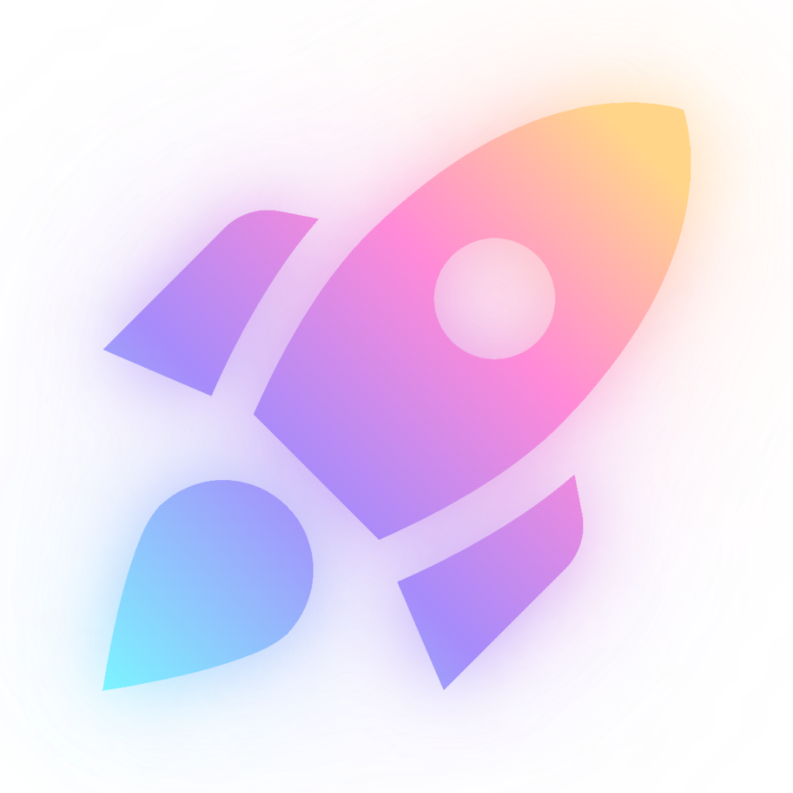

  # Cosmo Strike

  **A neon space shoot-'em-up: a choreographed 12-level campaign for mobile.**

  Built with Flutter + [Flame](https://flame-engine.org), dressed in the
  "Prism Noir" design system. Landscape-only, fully playable offline.
</div>

---

## What is it

Cosmo Strike is a horizontal shmup: pilot a starfighter through a **12-level
choreographed campaign** across four alien biomes, chaining combos, grazing
bullets to charge **Overdrive**, drafting upgrades between levels and downing
multi-phase bosses. Game modes (Classic, Zen, Time Attack, Survival, Onslaught,
and more) layer on top as modifiers. It ships with a full live-service layer:
leaderboards, a seeded **Daily Run**, daily challenges, weekly quests, events,
a battle pass, achievements, a coin economy with permanent **Hangar**
upgrades, ads, and a Pro subscription, all backed by the companion
`cosmo-strike-dotnet-api` (.NET 10) service in its own repository.

The gameplay runs on Flame's component system; **every other part of the app**
(menus, auth, leaderboards, store, progression, navigation) runs on a Flutter +
Bloc/Provider/Riverpod stack. Flame is scoped to the single gameplay screen.

> ⚠️ **Landscape only.** The app is locked to `sensorLandscape` and runs
> fullscreen immersive. Every screen is designed for a wide, short viewport.

## Screenshots

### Phone

| Home | Gameplay |
|:---:|:---:|
| 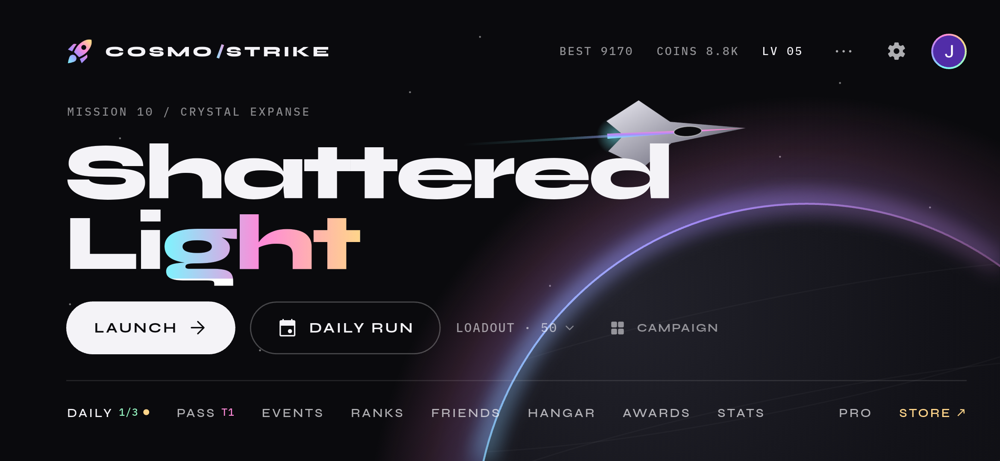 | 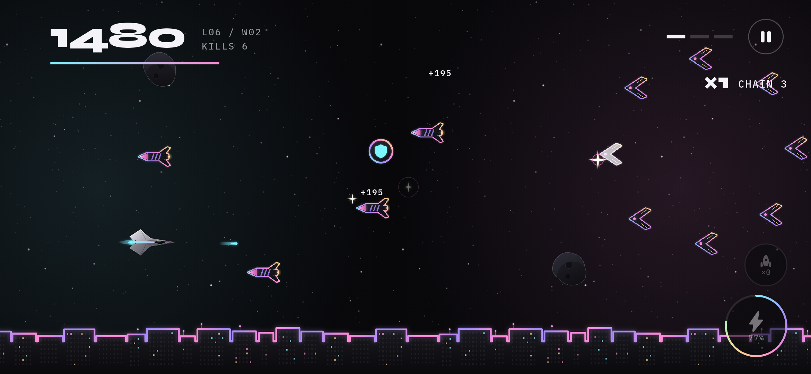 |
| **Boss Fight** | **Campaign** |
| 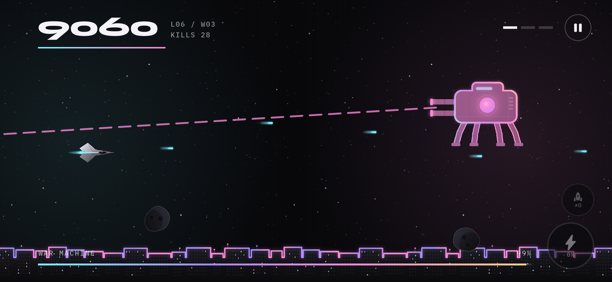 | 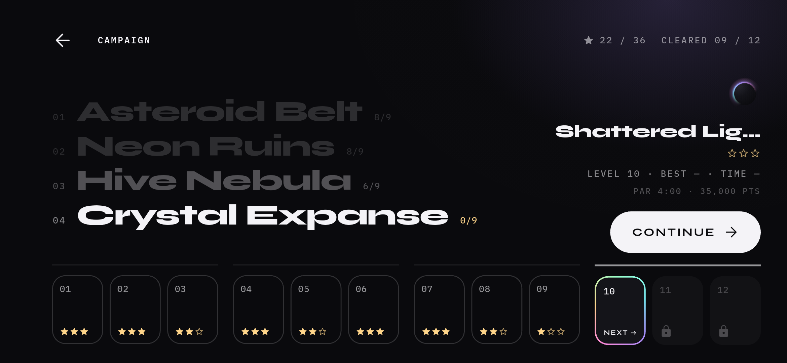 |
| **Hangar** | **Pause** |
| 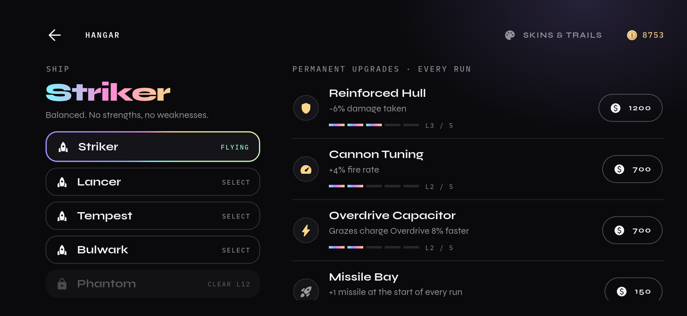 | 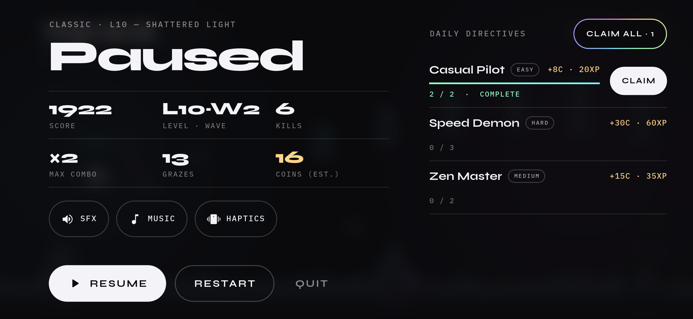 |
| **Game Over** | **Daily Challenges** |
| 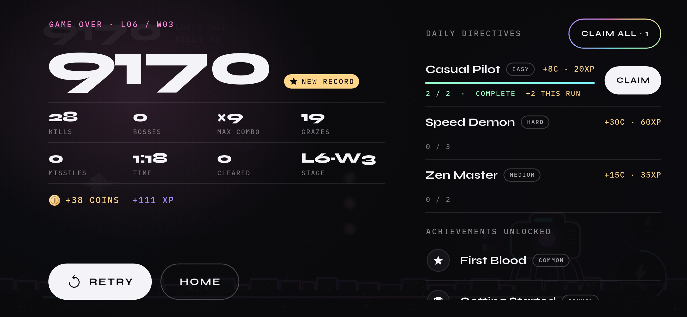 | 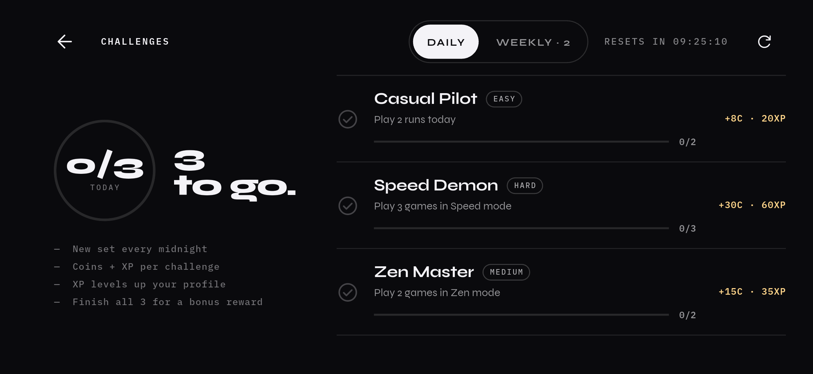 |
| **Battle Pass** | **Leaderboard** |
| 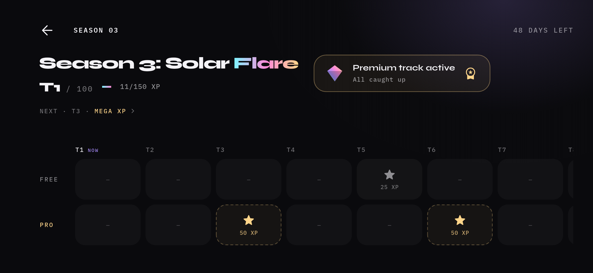 | 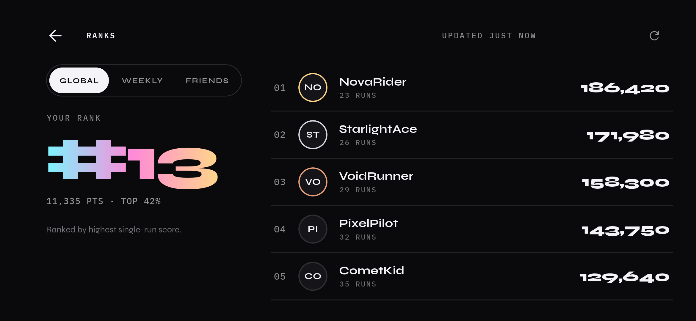 |
| **Events** | **Store** |
| 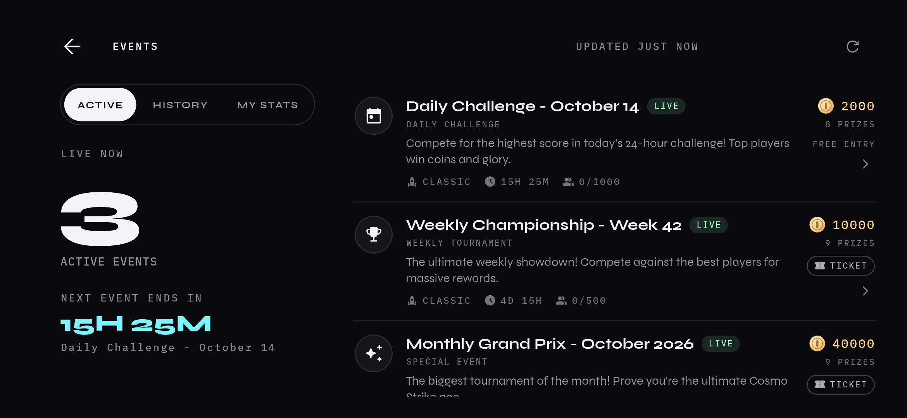 | 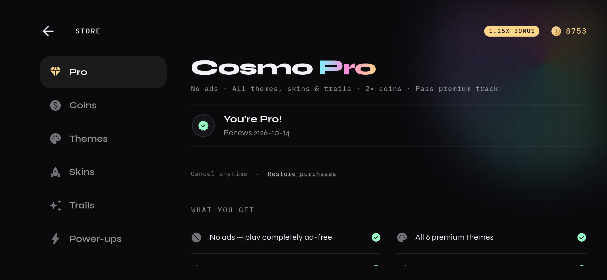 |

### Tablet

| Home | Gameplay | Boss Fight |
|:---:|:---:|:---:|
| 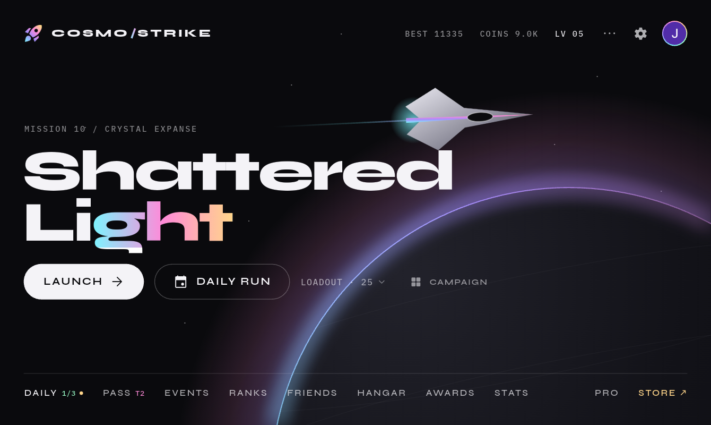 | 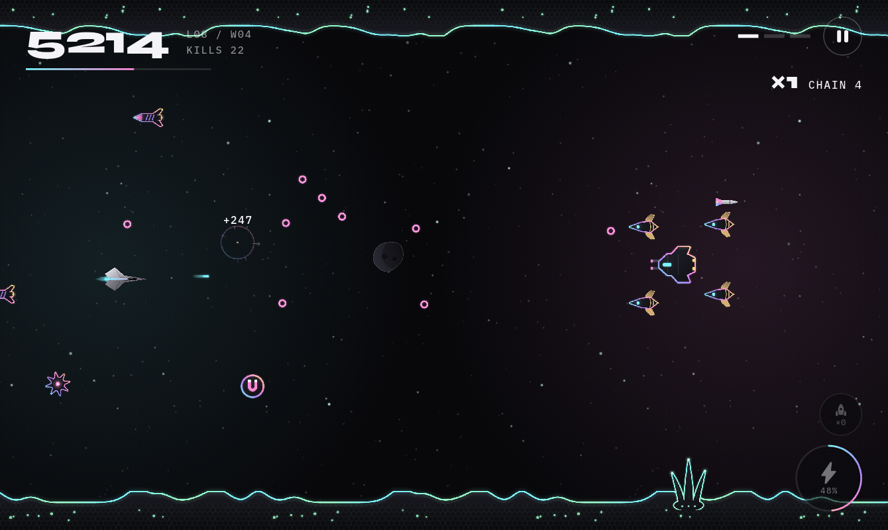 | 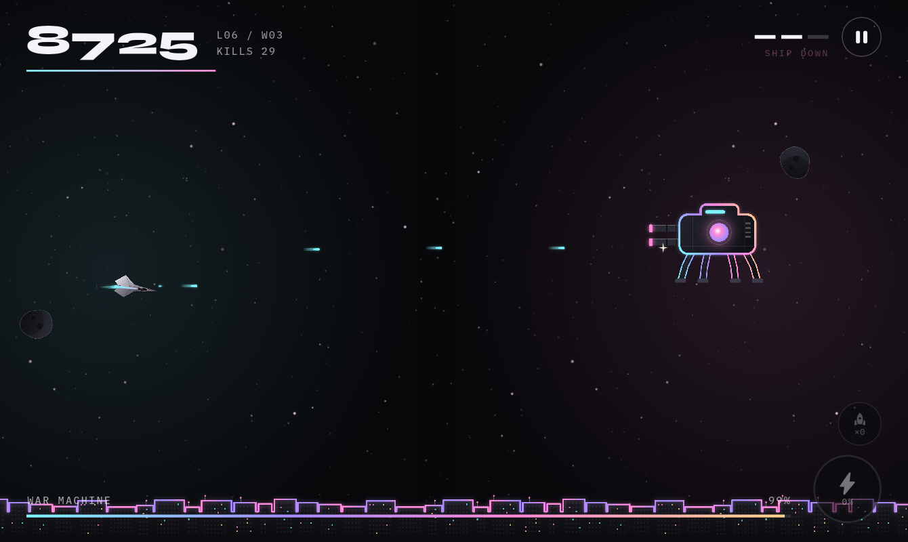 |
| **Campaign** | **Hangar** | **Battle Pass** |
| 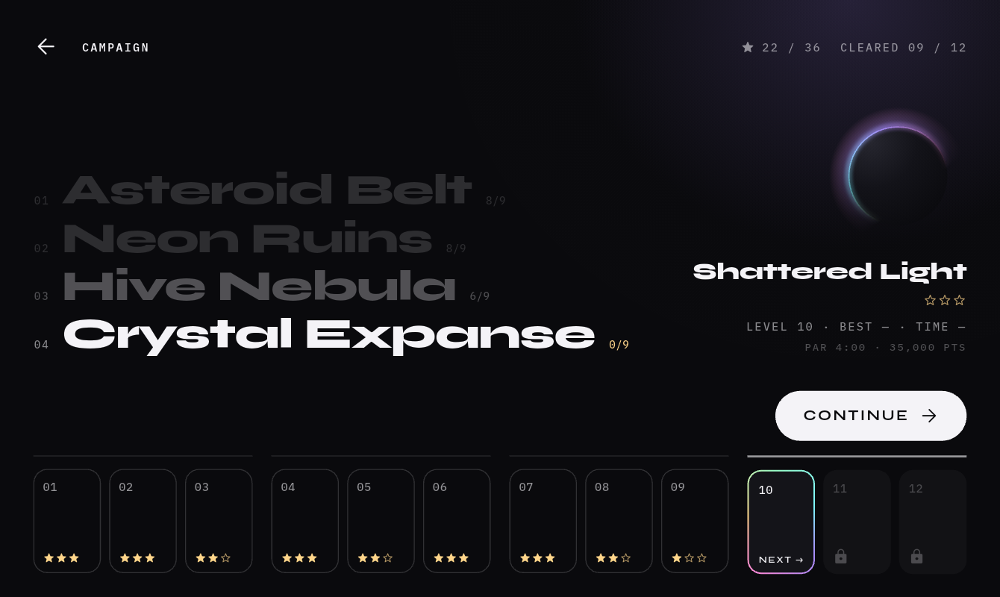 | 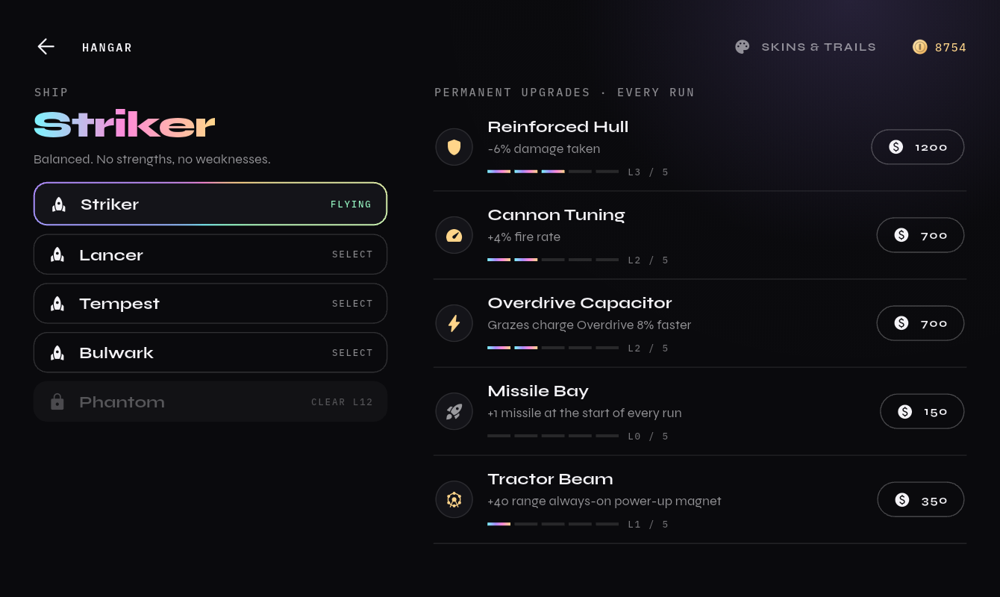 | 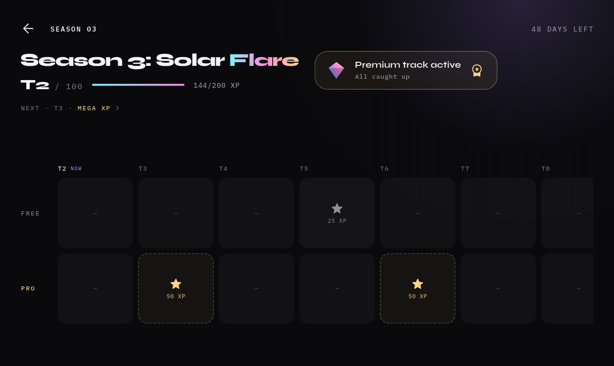 |

All 12 tablet captures are in [`tab_screenshots/`](tab_screenshots).

### Store listing assets

- Raw captures: [`screenshots/`](screenshots) (phone, 2340×1080) and
  [`tab_screenshots/`](tab_screenshots) (tablet, 1340×800).
- Google Play listing images: [`play_store_screenshots/`](play_store_screenshots)
  (phone, 2560×1440), [`play_store_screenshots_tablet_7in/`](play_store_screenshots_tablet_7in)
  (1920×1080) and [`play_store_screenshots_tablet_10in/`](play_store_screenshots_tablet_10in)
  (2560×1440).
- Feature graphic and logos: [`docs/store/`](docs/store).

## Gameplay (Flame engine)

Scoped to `lib/game/` and embedded via a single `GameWidget` on the gameplay
screen. All feel numbers live in `lib/game/tuning.dart`.

- **Choreographed levels**: each level is a `LevelScript` timeline
  (formations, drops, telegraphed set-pieces, boss events) with relative delays
  and barrier events that wait for a clear field. 12 levels across 4 biomes.
- **Formations**: 9 spawn shapes (stream, v-wedge, serpentine, pincer,
  wall-with-gap, column-dive, ambush-rear, ring-spinner, escort-convoy); wiping
  one fast pays a bonus and drops an orb.
- **Pressure**: aimed shots and bullet speed rise per level; flying clean
  raises enemy fire rate and aim, idling draws a sniper volley. The basic gun
  can't shoot bullets down (laser and Overdrive can).
- **Combo, graze and Overdrive**: kill chains drive a ×1–×4 score multiplier
  (breaks on a landed hit). Grazing bullets scores, extends the chain and fills
  the Overdrive meter; a full meter fires a 5 s piercing beam with ×2 score and
  a bullet-vaporising aura.
- **Upgrade draft**: pick 1 of 3 run upgrades after every level clear; they
  stack for the run, and the game-over debrief shows your build.
- **Hangar**: permanent coin upgrades (hull, cannons, capacitor, arsenal,
  tractor) plus ship frames unlocked by campaign clears.
- **Bosses**: per-type multi-phase kits where **every attack telegraphs**, with
  a WARNING intro, phase-flip hit-stops and a slow-mo kill.
- **Daily Run**: one date-seeded run per UTC day, the same layout for every
  pilot, attributed to that day's Daily Challenge event.
- **Terrain is gameplay**: animated floor/ceiling bands squeeze into corridors
  during set-pieces; turrets mount the terrain.
- **Modes**: Classic, Zen, Speed Challenge, Onslaught, Survival, Time Attack,
  Power-Up Madness, Perfect Game, layered on the campaign.
- **Controls**: drag-to-steer + auto-fire, double-tap or button for missiles,
  optional on-screen D-pad. One revive per run (rewarded ad, 200 coins, or
  free with Pro).

## First-run experience

There are no gates in front of the first run. A fresh install goes straight to
Home as a local guest; everything else is asked for later, at the moment it
matters:

- **Privacy**: a "By playing you agree to our Privacy Policy" strip on Home;
  starting a run records acceptance. Only players who accepted an older policy
  version see the blocking re-consent screen.
- **Home prompts** run one at a time: walkthrough, then daily bonus, then a
  game-mode picker after the first run, then a notification soft-ask after
  three runs (the OS permission dialog only follows "Turn on").
- **Sign-in** is offered on a new personal best after onboarding (budgeted),
  and from Profile, Settings and the purchase gate. Signing up keeps the guest's
  local progress and grants the 50-coin welcome bonus; signing in to an
  existing account restores its cloud save automatically.

## Architecture

```
lib/
├── main.dart                 # Boot: Firebase, GetIt DI, providers, router, sync engine
├── game/                     # Flame shmup (gameplay screen only)
│   ├── cosmo_strike_game.dart    # FlameGame: state machine, scoring, lives, level flow
│   ├── tuning.dart               # every gameplay feel number
│   ├── run_upgrades.dart         # upgrade draft catalog
│   ├── hangar.dart               # permanent upgrades + ship frames
│   ├── levels/                   # LevelScript, ScriptRunner, formations, level catalog
│   ├── components/               # player, enemies, bosses, bullets, power-ups, terrain, fx
│   └── combo_graze.dart          # combo multiplier, graze, Overdrive meter
├── theme/cosmo_theme.dart    # Prism Noir tokens + ThemeData
├── ui/cs/                    # Prism Noir components (barrel: ui/cs.dart)
├── presentation/bloc/        # Cubits: auth, theme, game settings, coins, premium, battle pass, ...
├── providers/                # Riverpod providers (leaderboards, daily challenges, walkthrough)
├── screens/                  # Home, campaign, hangar, leaderboards, store, battle pass, ...
│   └── gameplay_screen.dart      # Hosts the Flame GameWidget + HUD + overlays
├── widgets/                  # Shared widgets/overlays (draft, game over, prompts, ...)
├── services/                 # api, auth, purchases, ads, analytics, sync engine, FCM, first run
├── data/                     # Drift database + DAOs (offline-first), datasources
├── models/                   # Domain models
├── router/                   # go_router routes + transitions
└── utils/                    # constants (GameMode), campaign catalog, privacy policy, logger
```

### Offline-first (Drift is the source of truth)

The client's **local Drift database is authoritative** and the game is fully
playable offline:

- **Reads** come from Drift, never directly from the API.
- **Writes** are local-first + queued: a user action writes to Drift and
  enqueues an outbox item; `SyncEngine` pushes batches to the backend with
  retry/backoff when online.
- **Pull happens once per account per device, on first sign-in**, to hydrate
  a fresh device. After that the device never bulk-pulls again; local
  progress is authoritative. Signing out wipes local data, so the next
  sign-in restores that account's save.

**State management** is a deliberate hybrid: `flutter_bloc` (primary cubits) +
`provider` (services) + `flutter_riverpod` (secondary) + `get_it` (DI), with
**Drift** for the offline-first outbox sync engine.

**Key packages:** `flame` / `flame_audio` / `flutter_soloud`, `firebase_core` /
`auth` / `messaging` / `analytics`, `google_sign_in`, `in_app_purchase`,
`google_mobile_ads`, `go_router`, `drift`, `talker`,
`flutter_local_notifications`.

## Design system: "Prism Noir"

A near-black canvas with an iridescent prism gradient (cyan → violet → pink →
gold, plus mint) used sparingly as the only colour, big Syne headlines, IBM
Plex Mono uppercase labels, and 1 px hairlines instead of cards. Tokens live in
`lib/theme/cosmo_theme.dart`; components (`CsScaffold`, `CsSplit`, `CsButton`,
`CsTile`, `CsDialog`, `CsMarkdown`, …) in `lib/ui/cs/`, imported through the
`lib/ui/cs.dart` barrel. Every size scales through `context.cs` so screens look
designed from 640×360 phones up to 13" tablets.

Purchased colour themes tint **gameplay only** (via `CosmoPalette`); menus are
always Prism Noir. The mocks and rules are in [`docs/redesign/`](docs/redesign).

## Getting started

```bash
flutter pub get

# Generate Drift code (offline-first DB): required once / after schema changes
dart run build_runner build --delete-conflicting-outputs

flutter analyze     # must be clean
flutter test
flutter run
```

### Configuration

Two things are **not committed** (gitignored) and must be provided locally:

1. **`.env`** at the app root:
   ```env
   DEV_API_BACKEND_URL=http://localhost:8493
   PROD_API_BACKEND_URL=https://cosmostrike.pranta.dev
   GOOGLE_WEB_CLIENT_ID=<your-web-client-id>.apps.googleusercontent.com
   ```
2. **Firebase config**: `firebase_options.dart`,
   `android/app/google-services.json`, `ios/Runner/GoogleService-Info.plist`.
   Connect the app to your Firebase project with FlutterFire; these files are
   intentionally gitignored.

### Branding

The launcher icon and native splash are wired through the standalone
`flutter_launcher_icons.yaml` and `flutter_native_splash.yaml` (these override
pubspec; keep icon/splash config only there). Sources live in
`assets/branding/`. Regenerate with:

```bash
dart run flutter_launcher_icons
dart run flutter_native_splash:create
```

> ⚠️ `flutter_native_splash:create` rewrites `AndroidManifest.xml` and **strips
> `android:screenOrientation="sensorLandscape"`** from `MainActivity`. Re-add it
> after every regeneration or the app boots in portrait.

## Release (Play Store)

Release builds sign with the upload keystore via a gitignored
`android/key.properties` (the keystore itself lives outside the repo). The
version lives only in `pubspec.yaml`. Build the Play bundle with:

```bash
flutter build appbundle --release   # -> build/app/outputs/bundle/release/app-release.aab
```

## Backend

Leaderboards, score validation, progression sync, social, and subscription
verification are served by the `cosmo-strike-dotnet-api` (.NET 10) service,
which lives in its own repository.
